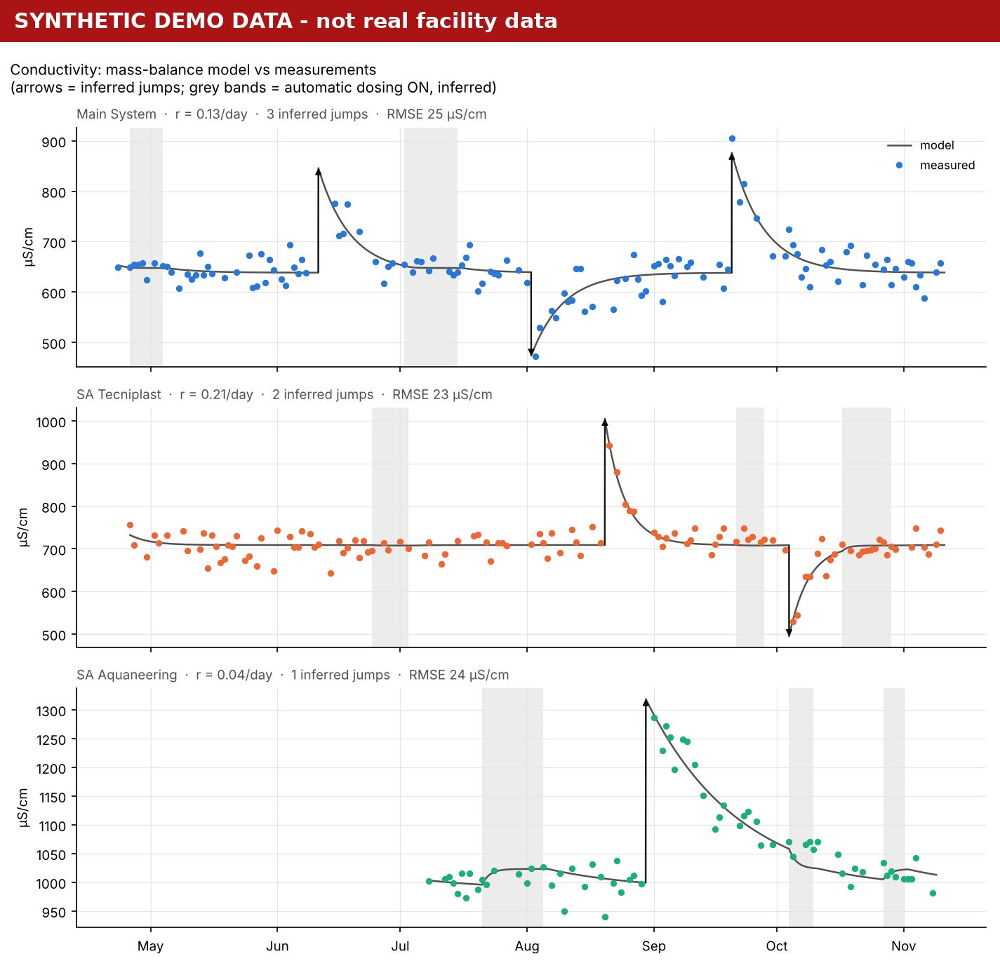

# Zebrafish water-quality modelling: process-based ODEs vs machine learning

> **Data disclaimer.** The real facility data are **not public** and are not in this repository.
> The results below come from the real data, but every figure here comes from a
> **[demo on synthetic data](demo/README.md)** that runs the same code. Demo figures are stamped
> "SYNTHETIC DEMO DATA".

An exploratory personal project that turns routine water-quality logs from three zebrafish
recirculating systems into **process-based (mechanistic) models**, **parameterises them with
uncertainty**, tests them on **an independent system**, and compares them against **small
machine-learning forecasters**, honestly and reproducibly.

## Motivation

Early-warning systems for disease in aquaculture rely on predictive monitoring of water quality.
Research facilities already collect daily water readings, but these are rarely modelled. This
project asks three questions with six months of real facility data:

1. Can simple mass-balance models explain conductivity and pH dynamics, and what do their
   parameters reveal about how the systems are run?
2. Are the parameters well determined, stable over time, and transferable to another system?
3. Do mechanistic models or ML models forecast the next reading better than "same as last
   reading"?

## Data

| | Main System | SA Tecniplast | SA Aquaneering |
|---|---|---|---|
| Volume | 525 L (3 × 175 L) | 175 L | 150 L |
| Period used | 23 Apr to 10 Nov 2026 | 23 Apr to 10 Nov 2026 | 8 Jul to 10 Nov 2026 |
| Readings (temperature, conductivity, pH) | 134 | 120 | 74 |
| Days covered | 66 % | 59 % | 59 % |
| Fish per litre | 2.4-2.6 | 0.7-1.9 | 5.1-7.1 |

* Manual daily readings exported from the facility's app.
* Tank records give fish counts over time (rebuilt from setup dates, mortality and archive dates)
  and cleaning dates.
* **Not recorded:** feeding (it exists in the app but is unreliable, so it isn't used), water
  changes, manual salt additions, makeup-water quality.
* **Data availability:** the facility data are **not included** in this repository. They belong
  to the host institution and are shared only with its permission. The code and report
  are public. `src/anonymise.py` shows how the exports were stripped of personal data before
  analysis. Researchers can request the anonymised data from the author.

## Models

**Conductivity: salt mass balance (ODE)**

$$\frac{dC}{dt} = r\,\big(C^{*} + g\,(T-\bar T) - C\big) + a(t)\,k\,(C_{set}-C) + \sum_j D_j\,\delta(t-t_j)$$

* *r*: effective renewal rate. Water is replaced with makeup water at this fraction per day.
* *C\**: the equilibrium conductivity without intervention. It is set by makeup-water salt
  concentrated by evaporation. Makeup conductivity and evaporation can't be separated without
  measuring the makeup water.
* *g*: optional temperature effect on evaporation. It is kept only if the data support it.
* *a(t) k (C_set − C)*: automatic dosing. It is active in periods detected as flat stretches
  of the record.
* *D_j*: jumps. Positive jumps are inferred manual salt additions and negative ones are
  dilutions or water changes. They are **inferred, not observed**.

**pH: linearised acid/CO₂ balance (ODE)**

$$\frac{dpH}{dt} = r\,(pH_{in}-pH) - \alpha\,\frac{F(t)}{V} + a(t)\,k\,(pH_{set}-pH) + \delta_c\,c(t) + \sum_j D_j\,\delta(t-t_j)$$

* *r*: relaxation rate, from renewal plus CO₂ degassing.
* *α F/V*: acid load from fish density.
* *δ_c c(t)*: effect of cleaning, scaled by the fraction of tanks cleaned that day.
* This is a first-order approximation of carbonate chemistry. No alkalinity data were
  available for a full model.

## Fitting method

* **Solving the ODEs.** Each model is linear with daily inputs, so it is solved exactly day by
  day and checked against `scipy.integrate.solve_ivp`.
* **Least squares.** For each value on a grid of rates *r* (and dosing strength *k*), the
  remaining parameters and jump sizes are fitted by least squares. The **LASSO** decides which
  gaps between readings need a jump, and a **modified BIC** (3 ln n per jump) picks the final
  model.
* **Term selection.** Optional terms are kept only if they improve BIC by more than 2. Fits
  outside physically plausible ranges are rejected.
* **Time split.** The models are calibrated on readings up to 31 Aug and validated on
  1 Sep to 31 Oct with next-reading forecasts. Future jumps are unknown to the model.
* **Uncertainty.** A moving-block residual bootstrap (300 resamples) gives 95 % intervals,
  conditional on the inferred jump dates.
* **ML comparison.** Persistence, ridge regression and gradient boosting (per system and
  pooled) are trained on the same split with past-only features. Bootstrap intervals are
  computed for the RMSE difference against persistence.

## Results

| Conductivity | Main | Tecniplast | Aquaneering |
|---|---|---|---|
| Renewal *r* (per day) | 0.080 | 0.300 | 0.027 |
| Implied exchange | ≈ 42 L/day | ≈ 52 L/day | ≈ 4 L/day |
| Equilibrium *C\** (µS/cm) | 709 | 651 | 1202 |
| Dosing set-point (µS/cm) | 747 | 744 | to |
| In-sample RMSE (µS/cm) / R² | 37 / 0.90 | 39 / 0.81 | 55 / 0.95 |

* **The nominal 10 %/day renewal is rejected for every system.** Main and Tecniplast exchange
  a similar volume of water, while Aquaneering exchanges about ten times less, which matches
  its higher conductivity.
* **pH has little structure the model can use.** No fish-load effect was detectable, even
  when Tecniplast's density nearly tripled. Tecniplast pH shows dosing and a possible cleaning
  effect (based on one event). Aquaneering pH is close to noise.
* **Transfer to Aquaneering:** transferring Main's *renewal rate* works (RMSE 59 vs 55 for its
  own fit), but transferring its *equilibrium* does not (RMSE 118).
* **Forecasting** (test Sep-Oct, RMSE):

| | Main cond. | Tecni cond. | Aqua cond. | Main pH | Tecni pH | Aqua pH |
|---|---|---|---|---|---|---|
| Persistence | 41.7 | 115 | 104 | 0.243 | 0.370 | 0.462 |
| Mechanistic ODE | 41.7 | 132 | 115 | 0.243 | **0.365** | 0.438 |
| Ridge (pooled) | 41.9 | 116 | 110 | 0.230 | **0.318** | 0.451 |
| Gradient boosting (pooled) | 40.3 | 124 | 116 | 0.209 | **0.332** | 0.403 |

  Bold means the method beats persistence with a 95 % bootstrap interval that excludes zero.

**Bottom line.** The mechanistic models are useful for *explanation*: they recover renewal
rates, set-points and unlogged interventions. Neither they nor ML can *forecast* conductivity
better than persistence, because the main drivers are unlogged human actions. Logging salt
additions and water changes, and measuring the makeup water, are the next steps that would
make predictive monitoring possible.

## Limitations

* The data come from one facility over six months, and 34-41 % of days are missing.
* Salt additions, dilutions and pH jumps are inferred, and their timing within gaps is assumed.
* Dosing periods are inferred from the record, not from controller logs.
* Makeup composition is assumed constant.
* The pH model is linear.
* Validation uses 32-46 forecasts per system.

See the report for details.

## Demo (runs without the real data)

```bash
pip install -r requirements.txt
python demo/run_demo.py
```



The demo also checks that the fitting code recovers parameters it was given: see
[demo/README.md](demo/README.md).

## Reproduce with the real data

```bash
pip install -r requirements.txt
python run_all.py          # about 4 minutes; rebuilds the cleaned data, figures and reports on your own data
```

`run_all.py` needs the anonymised exports in `data/raw_anonymised/`, which are not published
(see Data availability). With your own data in the same format, the pipeline runs unchanged.

| Folder | Contents |
|---|---|
| `data/raw_anonymised/` | anonymised exports (input; not published) |
| `data/clean/` | cleaned series, parameters, inferred events, metrics (created when you run the pipeline; not published) |
| `src/` | `audit.py` → `conductivity_model.py` → `ph_model.py` → `calibrate_validate.py` → `transfer_test.py` → `ml_compare.py` |
| `notebooks/` | `walkthrough.ipynb`, a guided tour of results |

## Author

Bruno Ferreira, zebrafish facility manager. This is an exploratory personal project.
